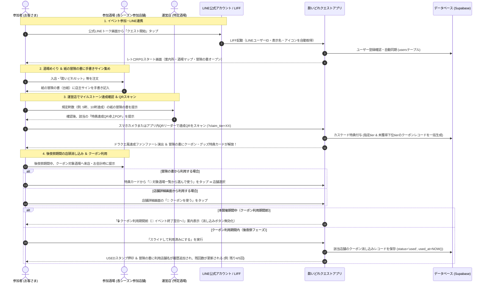
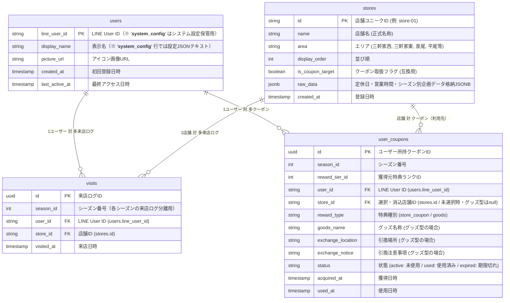
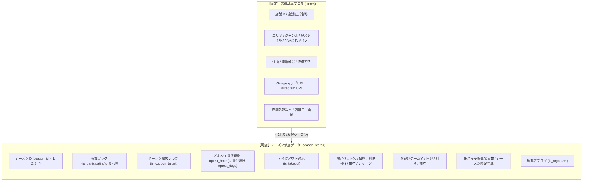
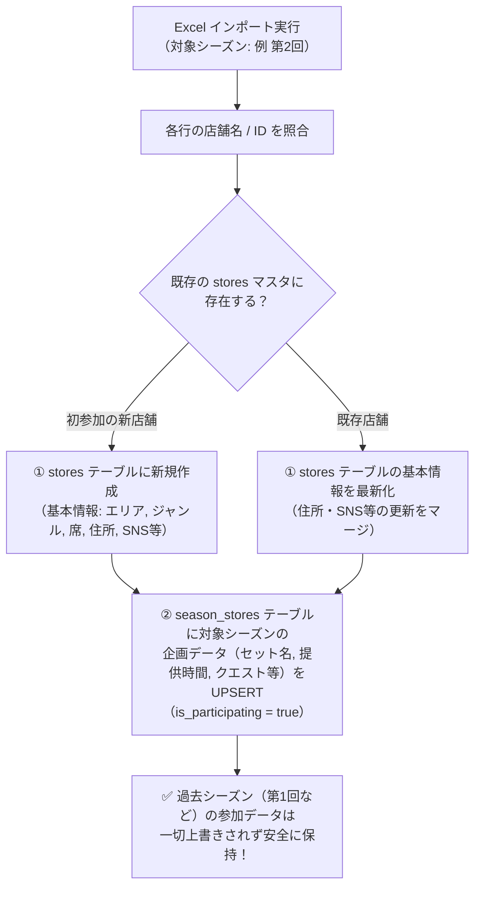

# 大正酔いどれクエスト - システム基本設計・機能仕様書

## 1. 概要と目的

### 1.1 プロジェクト概要
「大正酔いどれクエスト」は、大正区内の飲食店を巡る街ぶら・はしご酒イベント「大正酔いどれクエスト」の公式ガイド＆参加型クエストWebアプリです。

第1回イベントで好評だった「紙の冒険の書（台紙）」に店主が手書きサインを書くという**アナログな交流体験・接客負荷軽減**を軸とし、**LINE公式アカウントと連動したデジタル機能（マイルストーン達成QR解除・オンデマンド酒場クーポン・店頭消し込み）**を組み合わせた**「ハイブリッド運用モデル」**を採用しています。

### 1.2 主な目的とハイブリッド運用の背景
1. **店舗接客負荷の完全解消と偽造防止**: 全参加酒場での会計時個別QRスキャンを廃止し、紙の冒険の書（手書きサイン）で周遊。運営店（バックオフィスで `is_organizer: true` に指定された店舗）のみで達成軒数確認とQRスキャンを行うことで、参加店舗のオペレーション混乱を防止。
2. **LINE公式アカウントの友達獲得とエンゲージメント強化**: 参加導線をLINE公式アカウントに一本化。過去回次の友だち全員をそのまま引き継ぎ可能。
3. **カスケード特典付与（まとめ獲得）**: 参加者が上位のマイルストーン達成QR（例: 10軒達成QR）をスキャンした際、未獲得の下位特典（5軒達成分等）も自動で合算付与され、取りこぼしなく獲得可能。
4. **オンデマンド酒場クーポン方式（回数券チケット）＆直感的な一体型UI**: 獲得したクーポン利用可能枠（例: 5回分）は、イベント終了後のクーポン利用期間に来店時にその都度1店舗ずつ選んで消し込みを行う回数券チケット方式。冒険の書内で「獲得特典カード・クーポン利用可能期間・残枠・利用履歴」を一元管理。
5. **クーポン操作の一本化と店舗詳細での誤解防止**: 本開催期間中に店舗詳細で「クーポン」が表示されることによる「今すぐ使える」との誤解や会計時の店舗質問トラブルを防止するため、店舗詳細からはクーポンUI・ボタンを撤去。クーポン確認・利用操作は「冒険の書」画面に完全一本化。
6. **フェーズに応じたクーポン利用制御と動的期間明記**: 本開催中（サイン集め期間）はクーポンの消し込みをロックし、イベント終了翌日〜有効期限までの期間に対象店舗全店で使える運用を確立。UI上では「後夜祭」などの分かりにくい呼称を避け、「📅 利用可能期間: M/D(曜日) 〜 M/D(曜日)」「【イベント終了後に利用可能】」と動的日付に基づき明記。
7. **確実な店頭消し込み**: 特典利用時に店舗スタッフがスマホ画面上でスライド消し込み操作を実行し、規定回数の使い切りで特典コンプリート。二重利用を防止。
8. **安全な並行運用アーキテクチャ**: 9月末まで稼働している現行イベント・クーポンを一切阻害せず、同じLINEプロバイダー内で完全に共存・切り替え可能な設計。
9. **シーズン制（回次管理）アーキテクチャ**: 第2回、第3回、第4回…とソースコードの再構築なしにバックオフィスからワンクリックで開催回を切り替えられる設計。
10. **バックオフィス運営管理システム**: 特典ランク（5軒・10軒・15軒達成等）に応じた運営店専用卓上POP・QRコードの自動生成・A4印刷、ユーザー/クーポン管理・CSV出力を完備。

---

## 2. システム構成・アーキテクチャ

```mermaid
flowchart TD
    subgraph LINE [LINE プラットフォーム (プロバイダー: 大正酔いどれ)]
        LineOA[大正酔いどれ公式<br/>(Messaging API / 既存友だち)]
        CurrentLIFF[現行クーポンLIFF<br/>(9月末まで通常稼働)]
        LIFF[大正酔いどれクエスト LIFF<br/>(LIFF ID: 2011637649-WWv6pnTL)]
    end

    subgraph Client [クライアント (Webアプリ / GitHub Pages)]
        App[レトロRPG風 Webアプリ<br/>HTML5 / CSS3 / JavaScript]
        PaperBook[紙の冒険の書<br/>各酒場で手書きサイン収集]
        QRScanner[特典達成QRコード読み取り<br/>①通常スマホカメラ / ②アプリ内スキャナー]
        CouponUI[冒険の書 / 特典カード / 店頭消し込みUI]
        StoreGuide[案内所 / 酒場一覧（検索・詳細） / マップ]
        NoticeBanner[開催・クーポン利用期限動的バナー]
    end

    subgraph Backend [バックエンド (Supabase BaaS / Single Source of Truth)]
        Auth[LINE UID 認証・ユーザー管理]
        DB[(PostgreSQL データベース<br/>users / stores / visits / user_coupons)]
        Storage[(店舗ロゴ / 写真画像)]
    end

    subgraph Admin [バックオフィス運営管理システム (admin.html)]
        Dashboard[KPIダッシュボード / ランキング]
        Analytics[店舗・特典別 集計分析 / ソート・CSV]
        StoreManage[店舗マスターCRUD / クーポン対象ON/OFF]
        SeasonManage[シーズン作成・開催日程・アクティブ切替]
        TierManage[特典ランクCRUD (クーポン/グッズ/獲得称号)]
        DataManage[ユーザー・クーポン削除 & 状態復元]
        POPGen[運営店専用 特典達成QR POP一括印刷]
    end

    LineOA -->|トーク画面・リッチメニューから起動| LIFF
    LIFF -->|LINE UID / プロフィール連携| App
    App -->|リアルタイムデータ送受信| Backend
    PaperBook -->|運営店で手書きサイン提示| QRScanner
    QRScanner -->|マイルストーン達成解除 (?claim_tier=XX)| App
    NoticeBanner -->|フェーズ状態判定| App
    Admin -->|運営・削除・設定変更・POP印刷| DB
```

### 2.1 友だち限定セーフティガード (LINE Friendship Gate) 仕様

1. **アクセス制限と目的**:
   - 本アプリはLINE公式アカウントの友だち限定で利用可能な設計となっており、外部Webリンクや直接URL共有によって「友だち追加していないユーザー」や「公式アカウントをブロック中のユーザー」がアプリを操作することを防止します。
2. **LINE友だち状態の動的検証 (`liff.getFriendship()`)**:
   - アプリ起動時のLIFF認証（`initAuth()`）において、LINE SDKの `window.liff.getFriendship()` を実行し、公式アカウントの友だち追加フラグ（`friendFlag: boolean`）を取得・検証します。
   - `friendFlag === false`（未追加またはブロック中）と判定された場合、アプリ全体の操作を停止し、RPG風「🔒 友だち登録が必要です」全画面セーフティオーバーレイを表示します。
3. **ユーザー体験と復旧導線**:
   - セーフティオーバーレイ上からワンタップで公式アカウントの友だち追加画面（`https://line.me/R/ti/p/@277lqewi`）へ遷移可能。
   - 友だち追加完了後、「🔄 友だち追加したので再読み込み」ボタンをタップすることで即座にロックが解除され、ゲームを開始できます。
4. **開発・ローカル環境の互換性**:
   - LIFF環境外（PCブラウザローカル開発環境やバックオフィス管理画面）では、自動的にフレンドチェックをバイパス（`isFriend = true`）し、デバッグや管理業務を阻害しません。

### 2.2 システムファイル・モジュール構成一覧

本システムはビルドツールを必要としない完全なバニラ（HTML5 / ES6+ JavaScript / CSS3）の静的 Web アプリケーション（SPA）として構成されています。各モジュール・ファイルの責務と配置は以下の通りです。

```
C:\AG_WORK\yoidore-quest2/
├── README.md                   # プロジェクト概要・ドキュメント案内
├── index.html                  # 【ユーザーアプリ】メイン画面（スタート、案内所、酒場一覧、冒険の書、マップ、QRリーダー）
├── admin.html                  # 【バックオフィス】運営管理システム画面（ダッシュボード、店舗、シーズン、特典、参加者、分析、POP）
├── js/
│   ├── config.js               # システム設定（Supabase接続URL/anonKey、LIFF ID、公式LINE URL、testMode等）
│   ├── api.js                  # Supabase REST API通信層（認証、stores、visits、user_coupons、__system_config__ のCRUD）
│   ├── app.js                  # ユーザーアプリ制御層（LIFF初期化、フレンドシップガード、画面遷移、ステータス計算、演出）
│   └── admin.js                # バックオフィス制御層（Supabase Auth認証、Excelインポート、店舗・シーズン・特典管理、CSV出力）
├── css/
│   ├── app.css                 # ユーザーアプリ用スタイルシート（ドラクエ・レトロRPG風テーマ、アニメーション）
│   └── admin.css               # バックオフィス管理画面用スタイルシート（レスポンシブ、ダッシュボード、テーブルUI）
├── assets/                     # 共通画像アセット（アイコン、宝箱、バナー等）
├── photo/                      # 店舗外観・料理写真
├── data/                       # インポート用Excel等（店舗アンケート回答シート）
└── doc/                        # 仕様書・ドキュメント・SQL定義
    ├── SPECIFICATION.md        # システム仕様書（本ドキュメント）
    ├── CHANGELOG.md            # バージョン改定履歴
    ├── PROPOSAL_all_stores_conquest_special_date.md # 特定日・全店制覇設計書
    └── *.sql                   # 初期SQLスキーマ・マイグレーション用リファレンス
```

---

## 3. ユーザー体験（UX）フロー



---

## 4. データベース設計と物理運用アーキテクチャ (Supabase / PostgreSQL)

> [!IMPORTANT]
> **【AI・開発者向け 最重要アーキテクチャ・ガードレール（設計不変原則）】**
> 本システムは、サーバーレス/フロントエンド完結（SPA）におけるSupabase RLS権限トラブルの防止および原子的（アトミック）な設定同期を実現するため、**「設定ドキュメント（NoSQL型）ハイブリッド構造」** を採用して本番稼働しています。
> 1. **独自判断による設計・テーブル変更の絶対禁止**:
>    AIや実装者が独断で新しいテーブルを作成したり、`__system_config__` の読み書き先を別の物理テーブルへ切り替える等の設計変更を行ってはならない。必ず設計者（ユーザー）の明示的な指示に従うこと。
> 2. **稼働テーブルの厳守**:
>    実際に稼働している物理テーブルは **`users`, `stores`, `visits`, `user_coupons` の4つのみ** である。
> 3. **手動SQL実行時の設定レコード保護**:
>    テストデータ削除等で `users` テーブルを操作する際は、必ず `WHERE line_user_id != '__system_config__'` を付与し、システム設定レコードの巻き込み削除を絶対に防ぐこと。

---

### 4.1 物理テーブル稼働状況一覧

| テーブル名 | 物理稼働状態 | 役割と物理実装詳細 |
| :--- | :---: | :--- |
| **`users`** | **実稼働** | **① 一般ユーザー**: LINE UID, 表示名, アイコン画像, 最終アクセス日時<br>**② システム設定**: `line_user_id = '__system_config__'` の特別行にシステム全設定（シーズン、特典、称号）をJSON格納 |
| **`stores`** | **実稼働** | 店舗マスタ。物理カラムは `[id, name, area, display_order, is_coupon_target, raw_data]`。<br>※定休日・営業時間・シーズン別参加データ等はすべて `raw_data` (JSONB) に格納。 |
| **`visits`** | **実稼働** | 来店ログ。`[id, season_id, user_id, store_id, visited_at]`。`season_id` によりシーズンごとに完全分離。 |
| **`user_coupons`** | **実稼働** | ユーザー所持クーポン・グッズ引換記録。`[id, season_id, reward_tier_id, user_id, store_id, reward_type, goods_name, exchange_location, exchange_notice, status, acquired_at, used_at]`。 |
| **`reward_tiers`** | **非稼働 (形骸化)** | ※初期構築時の古いテストデータ2件が残骸として残っているのみ。**アプリや管理画面は一切アクセス（SELECT/INSERT）しない。** |
| **`seasons`** | **非稼働 (形骸化)** | ※初期スキーマの残骸。**アプリや管理画面は一切アクセスしない。** |
| **`hero_titles`** | **非稼働 (形骸化)** | ※初期スキーマの残骸。**アプリや管理画面は一切アクセスしない。** |

---

### 4.2 システム共有設定（`__system_config__`）の内部データ構造

Supabaseの `users` テーブル内の `line_user_id = '__system_config__'` 行における `display_name` カラムに、以下のJSON構造が文字列として格納され、アプリ（`js/app.js`）および管理画面（`js/admin.js`）間で同期されます。
※以下の値はデータ構造を示すスキーマ定義であり、特定シーズンの固定値ではありません（すべての値は管理画面から動的に設定されます）。

```json
{
  "seasons": [
    {
      "id": "<number: シーズン識別番号 (例: 1, 2, ...)>",
      "name": "<string: シーズン名称 (例: '大正酔いどれクエストⅡ')>",
      "start_date": "<string: 開催開始日 (YYYY-MM-DD)>",
      "end_date": "<string: 開催終了日 (YYYY-MM-DD)>",
      "coupon_valid_until": "<string: クーポン有効期限 (YYYY-MM-DD)>",
      "is_active": "<boolean: 現在開催中・アクティブフラグ>",
      "overview": "<string: イベント概要・ストーリー説明文>",
      "guide_steps": [
        {
          "step": "<string: ステップ番号 (例: '其の一')>",
          "title": "<string: ステップ見出し>",
          "desc": "<string: ステップ説明文>"
        }
      ],
      "rules_notes": "<string: 注意事項・飲酒マナーテキスト>",
      "initial_hero_title": "<string: 初期付与の称号名 (未設定時は空文字)>",
      "initial_badge_color": "<string: 初期バッジカラー (HEXカラーコード)>"
    }
  ],
  "current_season": {
    /* 現在アクティブなシーズン情報オブジェクト（上記 seasons 内の is_active: true の要素） */
  },
  "reward_tiers_by_season": {
    "<season_id文字列>": [
      {
        "id": "<number | string: 特典マイルストーンID>",
        "season_id": "<number: 所属シーズンID>",
        "reward_type": "<string: 特典種別 ('store_coupon' | 'goods')>",
        "is_all_stores": "<boolean: 全店制覇フラグ (trueの場合、全店舗達成特典)>",
        "title": "<string: 特典タイトル>",
        "required_visits": "<number: 達成に必要な来店軒数>",
        "selectable_count": "<number: クーポン選択可能枚数 (グッズ型の場合は1)>",
        "goods_name": "<string | null: グッズ名称 (グッズ型の場合のみ入力)>",
        "exchange_location": "<string | null: 引換場所 (グッズ型の場合のみ入力)>",
        "exchange_notice": "<string | null: 引換注意事項 (グッズ型の場合のみ入力)>",
        "hero_title": "<string: 達成時に獲得する称号名>",
        "badge_color": "<string: 称号バッジカラー (HEXカラーコード)>",
        "description": "<string: 特典内容の説明文>"
      }
    ]
  },
  "reward_tiers": [ /* 全シーズンのフラット配列（下位互換参照用） */ ],
  "hero_titles": [ /* 称号マスタ配列（互換用） */ ]
}
```

---

### 4.3 データベース論理・物理ER図



---

## 5. 実装機能一覧

| モジュール | 機能名 | 詳細・運用仕様 |
| :--- | :--- | :--- |
| **ユーザーアプリ** | **友だち限定セーフティガード (LINE Friendship Gate)** | LIFF認証時に `liff.getFriendship()` で公式アカウントの友だち状態を検証。非友だち・ブロック中の場合はアプリをロックし、RPG風オーバーレイから友だち追加へ誘導。 |
| **ユーザーアプリ** | **ボトムナビゲーション構成** | 【🍺 案内所】➔【🏮 酒場一覧】➔【📜 冒険の書（中央配置）】➔【📷 QR読取（フラット通常デザイン）】➔【📍 マップ】の5項目で統一。 |
| **ユーザーアプリ** | **酒場一覧（今期専有・過去非遷移）** | 迷いや誤認を防止するため、酒場一覧・店舗詳細画面は**常に現在開催中（アクティブ）のシーズンに参加している店舗（`is_participating = true`）と今期のセットメニューのみ**を表示。過去シーズンへの遷移は行わない。 |
| **ユーザーアプリ** | **冒険の書（歴代アーカイブ閲覧）** | 自分の冒険の思い出・達成履歴として、上部セレクターで「第1回の冒険の書」などを振り返り閲覧可能（過去回は読み取り専用でQR読取等はロック）。ロゴコレクションは**選択中シーズンに参加している店舗のみ**を動的に整列表示。 |
| **ユーザーアプリ** | **案内所（トップガイダンス）** | 現在開催中シーズンの概要・はしご酒の導き（3ステップ）・冒険の心得を動的表示。 |
| **ユーザーアプリ** | **アプリ内蔵カメラQRリーダー** | ボトムナビ「📷 QR読取」からWebカメラを起動し、運営店舗に設置されたマイルストーン達成QRコード（`?claim_tier=XX`）をスキャン。該当ランクおよび未獲得の下位ランク特典を一括カスケード自動解放。 |
| **ユーザーアプリ** | **ドラクエ風達成ファンファーレ＆メッセージウィンドウ演出** | 達成QRスキャン成功時に8bitレベルアップファンファーレSE・金紙吹雪/打ち上げ花火パーティクルとともに、ドラクエのステータス画面風レイアウト（アバター・なまえ・Lv・独立全幅の称号プレート）およびクラシックな黒枠メッセージウィンドウ（純白テキスト・アイコンなしスマート表示・自動ピコピコ文字送り＆タップスキップ対応）で獲得特典を演出。レベル数値は達成マイルストーンの必要軒数と完全一致（5軒達成でLv.5、20軒達成でLv.20等）。宝箱開封時の画面点滅（フリッカー）やSE二重鳴動を完全解消し、称号などの文字見切れを防ぎつつ下位特典の一括大量アンロック時も画面高を超えず「ぼうけんのしょを ひらく」ボタンが常時確実に押下可能。 |
| **ユーザーアプリ** | **冒険者ステータス欄（テーブル整列レイアウト ＆ 軒数連動Lv表示）** | なまえ、しょうごう、酒場クーポン残枠数のラベルと値を左揃えテーブル形式で整列表示し、視認性を大幅向上。レベル（Lv）は未達成時「Lv.1」から、各マイルストーン達成時の必要軒数（Lv.5、Lv.10、Lv.20等）と完全一致して連動表示。 |
| **ユーザーアプリ** | **開催フェーズ動的バナー** | 本開催中・後夜祭（クーポン利用期間）・期間終了の3状態を自動検知してヘッダーにリアルタイム告知。 |
| **ユーザーアプリ** | **クーポンオンデマンド店頭消し込み** | 後夜祭期間中、対象酒場で「スライドして利用済みにする」を実行し、該当店舗の消し込みレコードをDB即時同期（二重利用防止）。 |
| **ユーザーアプリ** | **記念品・グッズ店頭引換** | 運営店・引換所にて「スライドして受け取る」を実行し、グッズ受取レコードをDB即時同期。 |
| **バックオフィス** | **全機能シーズンセレクター連動** | ダッシュボード、店舗管理、シーズン設定、特典ランク、称号、集計分析のすべてが選択中シーズン（第1回/第2回/第3回…）と完全に連動。 |
| **バックオフィス** | **参加者データ管理（初回登録日・最終アクセス管理）** | ユーザーの初回登録日時（`users.created_at`）および最終アクセス日時（`users.last_active_at`）を愚直かつ正確に記録・管理。固定的な新規/既存フラグをあえて排除し、ありのままの事実データを表示・CSV出力。 |
| **バックオフィス** | **参加者・データ管理 サマリーストリップ ＆ コンパクトヘッダー** | 店舗マスターと同様のUI/UXを採用し、上部にサマリーKPIピル（全参加者、特典獲得者、クーポン残枠あり、記念品未引換、全枠消込完了、特典未獲得）を配置してワンタップで即時クイック絞り込み可能。状態フィルター・ソートを横幅自動調整のコンパクトコンボボックスに整理。フリーワード検索、一括リセット、リアルタイム件数表示（表示中: X / Y 名）を1行にスマート配置。消込履歴サブタブにも「[全種別] [🍺 クーポン] [🎁 記念品]」「[全状態] [✅ 消込・受取済] [⏳ 未使用・残枠]」の2連セグメントトグルを導入。 |
| **バックオフィス** | **店舗マスター2層分離管理 ＆ 統計サマリー・セグメントトグル・多軸フィルター** | 店舗の基本情報（`stores`）と、各シーズンの参加状況・企画メニュー（`season_stores`）を独立管理。上部に5つの統計KPIカード（登録店舗数・運営店数・セット提供数・クエスト提供数・クーポン取扱数）を配置し、クリックで即時クイック絞り込み可能。参加状態をセグメントトグル「[全店舗] [参加中] [不参加]」に刷新し、ドロップダウンの全幅伸長を廃止してスマートな横並びレイアウト（エリア選択、詳細条件ドロワー、リセット、リアルタイム件数バッジ「表示中: X / Y 軒」）を実現。 |
| **バックオフィス** | **アンケートExcel自動2層振分取込** | Googleフォーム集計結果のExcel（全38列）を解析し、対象シーズンを指定して「店舗基本マスタ更新」と「シーズン参加データUPSERT」を同時に実行。 |
| **バックオフィス** | **シーズン別 特典ランク・宝箱管理** | シーズンごとに独立した特典マイルストーン（必要軒数・クーポン型/グッズ型・引換設定）をGUIで完全作成・編集・削除。 |
| **バックオフィス** | **店舗・特典別 集計分析 (Analytics)** | 選択中シーズンの来店数・クーポン指名数・店頭消し込み実績一覧（ソート・エリア絞り込み対応）、およびCSV出力をサポート。 |
| **バックオフィス** | **全店舗POP一括印刷** | 全店舗の卓上QRコードPOP（A4レイアウト）を即座に印刷・PDF出力。 |

---

## 6. 店舗マスター 2層分離 ＆ アンケートExcelインポート仕様

### 6.1 店舗データの2層分離アーキテクチャ

イベントの継続開催・発展に伴い、店舗の「普遍的な基本情報」と「シーズンごとに変わる企画内容」を完全に分離して管理します。



### 6.1.1 物理DB実装マッピングと厳格な保存規約（PostgREST 400エラー防止規約）

本システムでは、Supabase（PostgreSQL）のテーブル定義の頻繁なマイグレーションを回避しつつシーズン別2層構造を実現するため、**`stores.raw_data`（JSONB）を用いた物理実装**を採用しています。

| 区分 | 格納場所 | 対象フィールド | 備考・注意点 |
| :--- | :--- | :--- | :--- |
| **物理カラム**<br/>（DBテーブル直下） | `stores` テーブルの直下カラム | `id`, `name`, `area`, `display_order`, `is_coupon_target`, `raw_data` | **これら以外のフィールドをルートのペイロードに含めて保存（POST/PATCH）すると `PGRST204`（カラム不在エラー）が発生します。** |
| **店舗基本情報** | `stores.raw_data` 直下 | `address`, `category`, `style`, `type`, `catchphrase`, `payment`, `map_url`, `insta_url`, `photo_url` 等 | 全シーズン共通の店舗情報 |
| **シーズン別企画データ** | `stores.raw_data.seasons[seasonId]` | `is_participating`, `is_organizer`, `is_coupon_target`, `plan_type`, `set_name`, `set_price`, `hours`, `days` 等 | 歴代シーズンごとに独立保存される企画情報 |

> [!IMPORTANT]
> **新属性追加時の鉄則**：
> 「運営店フラグ（`is_organizer`）」など新しい属性を画面・APIに追加する際は、**絶対に `stores` テーブルのルートペイロードに含めず、必ず `raw_data` および `raw_data.seasons[seasonId]` に格納してください。**

---

### 6.1.2 特定日限定営業店舗（1日のみ営業等）の運用規則と全店制覇算定ルール

> [!NOTE]
> **【ステータス: 運営メンバー検討中（保留中）】**  
> 本項の「特定日営業店舗を除外した全店制覇仕様」は、現在運営チーム内で合意形成中の提案仕様です。現行のコードおよびDBはまだ変更されていません。  
> 検討完了・合意後に、どのAI/開発者でも迷わず即座に安全・正確に実装できるよう、UI表示案・計算式・コード差分等をまとめた設計書 [PROPOSAL_all_stores_conquest_special_date.md](file:///C:/AG_WORK/yoidore-quest2/doc/PROPOSAL_all_stores_conquest_special_date.md) を策定済みです。

イベント期間中、極めて限定された日時（例: 期間中1日のみ・数時間のみ等）に限り営業を行う店舗（特定日限定営業店舗）が存在する場合があります。一般参加者が全店制覇（最高位特典マイルストーン）を目指すにあたり、特定日営業の参加可否によって達成不能や客足集中・売り切れクレーム等の現場トラブルが生じないよう、以下の**設計・運用ルール**を定めます。

#### ① 特定日限定営業店舗のデータ管理
- **特定日フラグ**: 各シーズンの店舗データ内 `special_date` に営業日（ISO日付形式: `YYYY-MM-DD`）を格納。
- **営業時間**: 各シーズンの店舗データ内 `quest_hours` に営業時間を格納。
- ※（参考）第2回実績値: `special_date = '2027-01-30'`, `quest_hours = '11:30〜15:30'`（店舗ID: `store-45`）。

#### ② 全店制覇特典（最高位マイルストーン）における必須除外ルール
1. **全店制覇の必要来店数（`required_visits`）の自動算出式**:
   - バックオフィスで特典マイルストーンの「👑 全軒制覇（全店舗達成）」を選択して保存する際、単に全参加店舗数を充てるのではなく、**「今期参加店舗数 − 特定日限定営業店舗（special_date設定あり）数」** を自動算出して登録する。
   - 計算式: $\text{required\_visits} = \text{参加店舗数} - \text{特定日営業店舗数}$
   - これにより、特定日営業の店舗に足を運ぶことができない参加者であっても、他の参加店舗を巡ることで**確実に「全店制覇」を達成可能**とする。
2. **特定日営業店舗に来店した場合の扱い（通常カウント）**:
   - 特定日営業店舗への来店も、正規のハシゴ軒数（`visits`）として1軒分カウントされる。
   - 他の店舗を1軒スキップしても、特定日店舗を訪れていれば所定軒数で全店制覇を達成できる（救済・代替店舗として機能する）。
3. **アプリ判定ロジックの不変原則（リアルタイム引き算の禁止）**:
   - アプリ側の判定は常に `visitedCount >= tier.required_visits` の単一絶対評価を維持する。
   - アプリ実行時に特定日店舗の有無を動的に差し引くような複雑な条件分岐は行わず、DBに保存された `required_visits` を唯一の真実（Single Source of Truth）として判定する。

#### ③ 画面表示・ユーザー周知仕様
1. **酒場一覧カード ＆ 店舗詳細モーダル**:
   - 特定日設定（`special_date`）がある店舗には、事実のみを淡々と補足する。
   > `※営業日時の都合上、本店舗へのご来店がなくても「全店制覇」を達成可能です。ご来店時は通常通りハシゴ件数（1軒）に加算されます。`
2. **冒険の書「全店制覇」宝箱カード**:
   - 余計な数字や言い訳を書かず、シンプルに達成目標を表示する。
   > `👑 条件: 全店舗達成`

---

### 6.2 画面別のシーズン表示仕様（整合性ルール）

| 画面 | シーズン切替 | 表示仕様・方針 |
| :--- | :---: | :--- |
| **🍻 酒場一覧・店舗詳細** | **不可**<br/>（今期固定） | **常に現在開催中（アクティブ）のシーズンに参加している店舗（`is_participating = true`）と今期企画メニューのみを表示**。<br/>一般参加者の迷いや店舗での注文トラブルを防止するため、過去シーズンの店舗リストへは遷移させない。 |
| **📜 冒険の書（パスポート）** | **切替可能**<br/>（アーカイブ） | **参加者自身の冒険の思い出・達成履歴**として、上部セレクターで「第1回の制覇記録」を振り返り閲覧可能。<br/>（※過去回は読み取り専用とし、QR読取やクーポン使用ボタンは誤操作防止のためロック） |
| **🏠 案内所（トップ）** | **不可**<br/>（今期固定） | **現在開催中シーズンの概要文・はしご酒の導き（3ステップ）・冒険の心得（注意事項）・および参加店舗（`is_participating = true`）に基づく動的コマンド選択件数（エリア数・ジャンル数・席スタイル数・タイプ数・対応中件数・総件数）を表示**。<br/>各探す画面で展開される選択肢の件数と100%動的連動。 |
| **💻 バックオフィス（管理画面）** | **全画面切替可能** | 管理者は「第1回」「第2回」「第3回」を自由に切り替え、それぞれの参加店舗・セット内容・特典・集計ログを閲覧・編集可能。 |

---

### 6.3 アンケートExcelの自動2層振分インポート仕様

運営事務局がシーズンごとに収集する店舗アンケート（Googleフォーム集計Excel: 全38列）を取り込む際、**指定したシーズンIDに対して安全に自動2層振り分け**を実行します。



---

### 6.4 Excel列 ➔ データベース（stores / season_stores）項目対照表

| Excel列（全38列） | 格納先テーブル | カラム・キー名 | 型 | 画面・用途 |
|---|---|---|---|---|
| A: タイムスタンプ | - | *(取込判定用)* | string | - |
| B: 店名 | `stores` | `name` | string | 酒場名（正式名称） |
| C: 参加意思 | `season_stores` | `is_participating` | boolean | 今期参加フラグ (`true` / `false`) |
| D: エリア | `stores` | `area` | string | エリアバッジ (三軒家西/東/駅前/泉尾/平尾) |
| E: カテゴリ | `stores` | `category` | string | ジャンル/カテゴリ (居酒屋, おばんざい等) |
| F: スタイル | `stores` | `style` | string | 席スタイル (カウンター, テーブル等) |
| G: タイプ | `stores` | `type` | string | 酔いどれタイプ (サク飲み, 腹ごしらえ等) |
| H: テイクアウト | `season_stores` | `is_takeout` | string | 今期のテイクアウト対応 (OK/不可/専門) |
| I: 提供曜日 | `season_stores` | `quest_days` | string | 今期の提供曜日 (`月,火,水,木,金,土`) |
| J: 開始 / K: 終了 | `season_stores` | `quest_hours` | string | 今期の提供時間 (`17:00〜22:00`) |
| L: 提供時間補足 | `season_stores` | `time_notes` | string | 提供時間補足バッジ (`土日祝は15時〜`) |
| M: 決済方法 | `stores` | `payment_methods` | string | 利用可能な決済方法 (現金, PayPay, カード) |
| N: クーポン希望 | `season_stores` | `is_coupon_target` | boolean | 今期のハシゴ達成クーポン取扱店フラグ |
| O: 参加企画 | `season_stores` | `plan_type` | string | 企画種別 (セット / クエスト / 両方) |
| P / AA: セット名 | `season_stores` | `set_name` | string | 今期の酔いどれセット名 |
| Q / AB: セット内容 | `season_stores` | `set_content` | string | セット内容詳細 |
| R / AC: セット備考 | `season_stores` | `set_notes` | string | セット内容備考・注記 |
| S / AD: 価格(税込) | `season_stores` | `set_price` | string / number | セット価格 (`1,000円`, `500円〜900円`, `¥1,000` 等の文字列を許容) |
| T / AE: チャージ料 | `season_stores` | `set_charge` | string | チャージ料 (`不要` / `¥300`) |
| U / AF: 限定数量 | `season_stores` | `set_limit` | string | 限定数量 (`無くなるまで`等) |
| V / AG: クエスト名 | `season_stores` | `quest_name` | string | お遊びゲーム名（Excel列名『クエスト名』とエイリアス互換） |
| W / AH: クエスト内容 | `season_stores` | `quest_content` | string | お遊びゲーム内容・達成報酬 |
| X / AI: 料金(税込) | `season_stores` | `quest_price` | string / number | ゲーム参加料金 (`無料`, `500円`, `500円〜900円` 等の文字列を許容) |
| Y / AJ: クエストチャージ | `season_stores` | `quest_charge` | string | ゲームチャージ料 |
| Z / AK: クエスト備考 | `season_stores` | `quest_notes` | string | ゲーム注意事項・備考 |
| AL: 缶バッチ希望数 | `season_stores` | `badge_sales_count` | string | 参加証(缶バッチ)販売希望数 |
| *(永続)* キャッチコピー | `stores` | `catch_copy` | string | 酒場カードのサブコピー |
| *(永続)* Google Map URL | `stores` | `map_url` | string | GoogleマップURL |
| *(永続)* Instagram URL | `stores` | `insta_url` | string | Instagram URL |
| *(永続)* 店舗写真 | `stores` | `photo_url` | string | 店舗代表写真 (`photo/001.jpg`) |
| *(永続)* 店舗ロゴ | `stores` | `logo_url` | string | 店舗ロゴ画像 (`logo/001.png`) |

---

### 6.4 データ型・クレンジング・正規化ルール

1. **提供時間（`hours`）**:
   - Excel内部の小数シリアル値（例: `0.5`, `0.625`, `0.708`）やTime型を判定し、`HH:mm〜HH:mm` 形式（例: `15:00〜22:30`, `12:00〜00:00`）へ自動変換。
2. **提供曜日（`days`）**:
   - `全て` ➔ `月,火,水,木,金,土,日`
   - 「月曜日」「火曜日」等の「曜日」の「日」に誤爆しないよう正規表現（`/日曜日|日曜/`）で厳密に判定し、`月,火,水,木,金,土` 形式に正規化。
3. **価格・料金（`set_price`, `quest_price`）**:
   - `500円〜900円` などの価格幅表記や `男性2000円　女性1500円`、`無料` 等の柔軟な記述に対応するため、**文字列（`string`）を許容**。アンケートExcelの値を生の文字列のまま欠落なくインポートし、バックオフィスで自由に修正・調整可能な運用設計とする。アプリ表示時は純粋な数値なら `¥1,000 (税込)`、文字列・範囲なら `500円〜900円 (税込)` と自動判別整形。
4. **チャージ料・限定数量（`set_charge`, `set_limit` 等）**:
   - `None` や空文字は `不要` または `""` にクレンジングし、酒場の自由記述（例: `酔いどれセットの方は０円`, `おばんざいが無くなるまで。`）をそのまま尊重して保持。
5. **スタイル（`style`）**:
   - `テールブあり` などの誤字補正を行いながら、`カウンターメイン、テーブル1席あり` などの詳細記述をそのまま維持。
6. **既存マスタ情報保護（写真・ロゴ・地図URL・キャッチコピー）**:
   - アンケートExcelに含まれないシステム管理項目（`photo_url`, `logo_url`, `map_url`, `insta_url`, `catchphrase`）は、インポート時に既存マスタ（DB）の値を自動継承し、空文字上書きを防止。

---

### 6.5 2層データモデルのスキーマ定義（店舗マスタ ＋ シーズン別参加企画データ）

データベースでは、店舗の基本マスタ情報と、シーズンごとの参加企画データを以下の論理・物理スキーマ構造で管理します。
※以下はデータ構造と型を示すスキーマ定義であり、特定店舗の固定値ではありません（すべての値は管理画面およびExcel取込から動的に設定・管理されます）。

#### ① 店舗基本マスタ（`stores` テーブルのルート属性および共通 `raw_data`）
```json
{
  "id": "<string: 店舗ユニークID (例: 'store-01')>",
  "name": "<string: 店舗名（正式名称）>",
  "area": "<string: エリア区分 (三軒家西, 三軒家東, 泉尾, 平尾等)>",
  "category": "<string: ジャンル/カテゴリ (居酒屋, バル, バー等)>",
  "catchphrase": "<string: 店舗キャッチコピー>",
  "style": "<string: 席スタイル (カウンター, テーブルあり, 立ち飲み等)>",
  "type": "<string: 呑みタイプ (サク飲み, 昼飲み, 深夜営業等)>",
  "address": "<string: 店舗住所>",
  "tel": "<string: 電話番号 (任意)>",
  "payment": "<string: 利用可能決済方法カンマ区切り (現金, PayPay, クレジットカード等)>",
  "map_url": "<string: GoogleマップURL (任意)>",
  "insta_url": "<string: 公式Instagram URL (任意)>",
  "photo_url": "<string: 店舗写真URL (任意)>",
  "logo_url": "<string: 店舗ロゴURL (任意)>",
  "display_order": "<number: 一覧表示順序番号>",
  "is_coupon_target": "<boolean: クーポン取扱フラグ (互換用)>",
  "is_organizer": "<boolean: 運営店・引換所フラグ>"
}
```

#### ② シーズン参加・企画データ（`stores.raw_data.seasons["<seasonId>"]`）
各シーズン（例: `"1"`, `"2"`）ごとの参加企画データは、`stores.raw_data.seasons` 内のシーズンIDをキーとするオブジェクトに分離保持されます。
```json
{
  "is_participating": "<boolean: 当該シーズンへの参加フラグ>",
  "plan_type": "<string: 参加企画種別 ('「酔いどれセット」のみで参加' | '「お遊びゲーム」のみで参加' | '「酔いどれセット」・「お遊びゲーム」両方で参加')>",
  "days": "<string: イベント提供曜日カンマ区切り (例: '火,水,木,金,土,日')>",
  "hours": "<string: 通常営業時間 (例: '17:00〜23:00')>",
  "quest_hours": "<string: クエスト/セット提供可能時間帯 (例: '18:00〜22:00')>",
  "special_date": "<string: 特定日営業日 (YYYY-MM-DD形式。特定日営業店舗のみ設定、通常は空文字)>",
  "time_notes": "<string: 営業時間に関する補足・特記事項 (任意)>",
  "takeout": "<string: テイクアウト対応可否 ('テイクアウトOK' | 'テイクアウト不可')>",
  "is_coupon_target": "<boolean: 当該シーズンにおけるクーポン利用対象フラグ>",
  "set_name": "<string: 酔いどれセット料理名>",
  "set_content": "<string: セット内容詳細 (例: 'おまかせおつまみ3品+生ビール1杯')>",
  "set_price": "<string | number: セット価格 (例: 800 または '800〜1,000')>",
  "set_charge": "<string: チャージ料金情報 (例: 'なし', '通常300円が無料')>",
  "set_limit": "<string: 1日あたり限定数 (例: '1日限定15食', 'なくなり次第終了')>",
  "set_notes": "<string: セットに関する注意事項・補足>",
  "quest_name": "<string: お遊びゲーム/店舗クエスト名 (任意)>",
  "quest_content": "<string: クエスト内容詳細 (任意)>",
  "quest_price": "<string | number: クエスト価格 (任意)>",
  "quest_charge": "<string: クエスト時チャージ (任意)>",
  "quest_notes": "<string: クエストに関する注意事項 (任意)>",
  "badge_sales_count": "<string | number: バッジ販売目標数/実績数 (任意)>"
}
```

---

### 6.6 バックオフィス店舗入力・編集画面（admin.html）の連携仕様

1. **席スタイル（`style`）の自由記述対応**:
   - 既定選択肢（`テーブルあり`, `カウンター`, `立ち飲み`, `テイクアウト専門`）に加え、`その他 (直接入力)` をサポート。
   - アンケートで自由入力された詳細（例: `カウンターメイン、テーブル1席あり`）を丸めずに保持・編集可能とする。
2. **参加企画（`plan_type`）の選択**:
   - `「酔いどれセット」・「お遊びゲーム」両方で参加` / `「酔いどれセット」のみで参加` / `「お遊びゲーム」のみで参加` のプルダウン選択（既存データの「店舗クエスト」表記とも完全互換）。
3. **新規シーズン作成時の店舗データ初期化・引継ぎ**:
   - 新規シーズン作成時は、初期状態で全店舗が「未参加」として安全に作成される。
   - アンケートExcelのインポート、または「前シーズンの参加店舗設定を一括コピー」操作により、瞬時に新シーズンの参加店舗マスタを構築可能。
4. **決済方法（`payment`）の双方向同期**:
   - チェックボックス（現金/カード/PayPay等）と、「その他決済」テキスト欄を組み合わせて自由記述（QR決済の種類等）を漏れなく保持。
5. **店舗情報の確実な保存・即時反映（CRUD安定化）**:
   - 既存店舗の編集保存時は、選択中シーズンに対応する `season_stores` と基本マスタ `stores` の双方へ安全に保存を実行。

---

### 6.7 店舗マスター管理画面（admin.html）のスマートレイアウト・統計ピル仕様

店舗一覧画面において、縦幅の肥大化によるテーブル一覧の圧迫を解消し、業務効率と視認性を最大化する**省スペース・スリムUI**を採用しています。

1. **5大統計ピル型バッジストリップ（`.store-summary-strip`）**:
   - テーブルカード上部に、高さを抑えた1行のピル型バッジ（`全登録店舗数 (参加/不参加)`、`運営店`、`酔いどれセット提供`、`お遊びゲーム提供`、`クーポン取扱店`）を常時表示。
   - 各ピルをクリックすることで、該当属性への**クイック絞り込み**がワンタップで実行可能。
2. **1行コンパクトヘッダー（`.store-compact-header`）**:
   - 「🔍 複合フリーワード検索入力」、「エリア選択」、「参加状態（参加/不参加/すべて）」の最重要検索項目を横1行に統合配置。
   - 現在のヒット件数（例: `表示中: 33 / 35 軒`）と、一括リセットボタンをインライン表示。
3. **詳細条件展開ドロワー（`.advanced-filter-drawer` / アコーディオン）**:
   - 利用頻度の低い「参加プラン（両方/セットのみ/クエストのみ）」、「クーポン取扱（対象/対象外）」、「店舗種別（運営店/一般店）」は「⚙️ 詳細条件」ボタン押下時のみスライド展開。
   - 詳細条件が1つでも適用されている場合はボタン横にアクティブバッジ（`●`）が点灯し、ドロワーを閉じた状態でも絞り込み状況が直感的に判別可能。

---

## 7. 店舗・特典別 集計分析機能（Analytics）の仕様

バックオフィス管理画面の「📊 店舗・特典別 集計分析」画面（`#tab-analytics`）は、**選択中シーズン（第1回/第2回/第3回…）に絞り込んで**、イベント開催中の動向分析や、イベント終了後の各参加店舗への実績フィードバック（送客数・クーポン精算データ）を即座に集計・出力するための機能です。
「店舗マスター管理」「参加者・データ管理」と同様に、**①サマリーストリップ（KPIピル・ワンクリック絞り込み）**、**②1行コンパクトヘッダー（セグメントトグル・コンパクトセレクト・リセット・リアルタイム件数表示）** の共通仕様に完全統一されています。

### 7.1 全酒場 実績集計一覧（オンデマンド消し込み対応）
1. **集計指標（選択中シーズン `season_id` で完全フィルタリング）**:
   - **🍺 クーポン利用 (消込)**: 選択中シーズンにおいて実際に酒場でオンデマンド提示・消し込みが行われた総数（`user_coupons WHERE season_id = selectedSeasonId AND status = 'used' AND reward_type != 'goods'`）。
   - **🎟️ クーポン対象**: 該当酒場がシーズン特典クーポンの利用対象店舗として登録されているか（`season_stores.is_coupon_target`）。
2. **抽出条件・操作仕様（他管理画面と統一）**:
   - **サマリーストリップ（KPIピル）**:
     - `全酒場`: 全登録酒場数
     - `🍺 利用実績あり`: クーポン利用（消込）が1件以上の酒場
     - `⏳ 利用なし (0件)`: クーポン利用がまだない酒場
     - `🎟️ クーポン対象店`: ハシゴ達成特典の引き換え対象酒場
   - **1行コンパクトヘッダー**:
     - **検索ボックス**: 酒場名・ID・エリアを対象としたインクリメンタル検索（`search-input-wrapper-sm`）。
     - **セグメントトグルボタン**: `[全酒場] [🍺 利用あり] [⏳ 利用0件] [🎟️ クーポン店]` の直感的一発切り替え。
     - **エリアセレクト**: `form-select-sm` による横幅最適化プルダウン（三軒家西、三軒家東、泉尾、平尾など）。
     - **企画セレクト**: `form-select-sm` による参加企画絞り込み（すべて / 両方参加 / セットのみ / クエストのみ）。
     - **ソートセレクト**: `form-select-sm` による並び替え（利用数順 降順/昇順、酒場ID順、酒場名順）。
     - **リセットボタン**: 全抽出条件を初期値へ即時復元。
     - **表示件数バッジ**: `表示中: X 軒` をリアルタイム反映。
   - **CSV出力**: 選択中シーズンの全参加酒場実績テーブルデータをExcel互換（UTF-8 BOM付き）CSVとしてワンクリックダウンロード。

### 7.2 特典・グッズ別 達成＆消し込み集計（一覧表テーブル形式）
1. **集計指標**:
   - **🎁 記念品グッズ引換型**: `達成者数 (資格者)`、`消込・受取済点数`、`未利用・未受取残数`、`消化・受取進捗率 (%)` を正確に算出・プログレスバーとともに可視化。
   - **🍺 酒場クーポン型**: `達成者数 (資格者)`、`店頭消込済数`、`未利用残枠数`、`消化進捗率 (%)` を正確に算出・プログレスバーとともに可視化。
2. **抽出条件・操作仕様（他管理画面と統一）**:
   - **サマリーストリップ（KPIピル）**:
     - `全マイルストーン`: 登録されている全特典ランク数
     - `🍺 店舗クーポン型`: 酒場クーポン選択型特典数
     - `🎁 グッズ引換型`: 記念品引換型特典数
     - `👥 達成者あり`: 獲得達成者が1名以上いる特典
   - **1行コンパクトヘッダー**:
     - **検索ボックス**: 特典名・称号・内容・グッズ名を対象としたインクリメンタル検索。
     - **セグメントトグルボタン**: `[全種別] [🍺 クーポン型] [🎁 グッズ型]` のワンタップ切り替え。
     - **状態セレクト**: `form-select-sm` による状態絞り込み（すべて / 達成者あり / 未利用・未受取残あり / 全て消化済 / 達成者ゼロ）。
     - **ソートセレクト**: `form-select-sm` による並び替え（必要軒数順 昇順/降順、達成者数順、消込・受取数順、残数順）。
     - **リセットボタン**: 全抽出条件を初期値へ即時復元。
     - **表示件数バッジ**: `表示中: X 件` をリアルタイム反映。
   - **CSV出力**: 選択中シーズンの全特典別実績集計データをExcel互換（UTF-8 BOM付き）CSVとしてワンクリックダウンロード。

---

## 8. 冒険の書「酒場ロゴコレクション」UI仕様

冒険の書画面の「ハシゴ済み酒場」エリアは、選択中シーズンに参加している全店舗のロゴをタイルのようにグリッド配置した**図鑑風コレクションUI**として設計されています。

### 8.1 タイル表示ルール
1. **選択中シーズンの参加全店舗グリッド配置**:
   - 選択中シーズンに参加している全店舗（`season_stores.is_participating = true`）を動的に抽出し、表示順（`display_order` または店舗ID連番）で整列。
   - スマートフォン幅で4列（幅広画面で5列）の正方形タイル（アスペクト比 1:1）で一覧表示。
2. **未制覇（サイン未受取）**:
   - 明るめのグレースケール（白黒 ＋ 透過度75% ＋ 明るさ90% ＋ `#1e293b` 背景）。
   - まだ訪れていない場所でもロゴの形状・シンボルがはっきりと視認でき、探索意欲を向上。
3. **制覇済み（サイン受取後）**:
   - フルカラー ＋ ゴールド発光枠 ＋ ネオンシャドウ（`border-color: #facc15; box-shadow: 0 0 10px rgba(250, 204, 21, 0.45);`）。
   - 巡れば巡るほどタイルが明るく点灯し、コレクションの達成感を最大化。
4. **表示のミニマリズム**:
   - タイル盤面上には通し番号や店舗名、日時のテキストを一切配置せず、**ロゴ画像のみ**をクリーンに整列。

### 8.2 インタラクション（タップ時の店舗確認モーダル）
- ロゴタイルをタップすると、レトロRPG風の「📜 酒場コレクション確認モーダル」がポップアップ。
  - **店舗ロゴ（拡大・カラー）**
  - **店舗名 ＆ エリア・カテゴリ**
  - **制覇ステータス**（制覇済みの場合は「✨ 制覇済み（YYYY/MM/DD HH:mm 記録）」、未制覇の場合は「🔒 未制覇」）
  - **「🏮 酒場詳細を見る」ボタン**（店舗個別詳細画面へダイレクト遷移）

---

## 9. データ取得・フォールバック偽装の完全禁止規約 (Strict Data Integrity Policy)

本システム（ユーザーアプリ、バックオフィス管理画面、API通信層の全領域）において、**データ欠損・未定義時にコード内の固定値（ダミー文字列・仮データ）を代入・フォールバック表示して正常に見せかける実装を恒久的に全面禁止**とします。

### 9.1 禁止事項（Anti-Patterns）
1. **未定義プロパティに対する固定文字列・固定値の暗黙補填の禁止**:
   - `newHero?.title || '初陣'`、`newHero?.level || 2`、`season.name || '大正酔いどれクエスト'` のように、プロパティが存在しない・取得できない場合にコード内の固定値をフォールバック代入する処理の禁止。
2. **新規作成・入力ダイアログにおける固定値・決め打ち文字列の自動初期セット禁止**:
   - 新規作成モーダル（特典ランク、店舗マスター、シーズン開催設定等）の入力欄（`<input>` や `<select>`）に、あらかじめ固定のタイトル、数値、エリア、カテゴリ、営業情報等を初期値（`.value`）として強制プリセットする処理の禁止。
   - 入力例・ガイダンスは必ず HTML の `placeholder` 属性（例: `placeholder="例: 5軒ハシゴ達成特典"`）またはヘルプテキストで提示し、実際の入力値は完全な空文字（`""`）または未選択状態（`value=""`）で開くこと。
3. **引数不整合やデータ欠損の隠蔽の禁止**:
   - 呼び出し側の引数エラーやオブジェクト構造の不整合が発生した際、デフォルト値で画面を成立させてバグを正常に見せかける処理の禁止。
4. **データベース設定に存在しないダミーマスタのハードコード禁止**:
   - データベース（Supabase）上に登録されていない店舗情報、特典ランク、勇者称号、ガイダンス・心得、シーズン設定等をプログラム内に固定値として埋め込み、それを代替表示する処理の禁止。

### 9.2 遵守すべきデータ設計・実装原則
1. **データベース（Single Source of Truth）の絶対遵守**:
   - すべての称号、特典、店舗、シーズンデータはデータベースを唯一の真実として扱い、DBマスタから取得した実データを厳格に使用する。
2. **新規入力フォームにおけるクリーン初期化とプレースホルダー活用**:
   - 新規作成時のフォーム入力欄は一切の決め打ち初期値を排し、空文字・未選択で初期化する。利用者の入力負担軽減・誘導は `placeholder` の例示または入力バリデーションによって行い、意図しない固定値がそのままDBに登録される事故を根絶する。
3. **データ欠損・未取得時の明示的ハンドリング**:
   - データが存在しない場合は、勝手な仮データを捏造せず、空状態（`[]`）、未設定表記（例: `-` や未設定メッセージ）、または開発・デバッグ環境で即座に検知可能なログ・エラーハンドリングを行う。
4. **引数シグネチャの厳密な型・構造チェック**:
   - コンポーネントやモーダル関数は、期待するオブジェクト構造を明確にし、データ不整合時はフォールバックで誤魔化さず根本原因を即座に特定・修正できる構造を維持する。

---

## 10. バージョン改定履歴 (Changelog)

本仕様書およびシステムの詳細な改定履歴・機能改修ログは、仕様書の可読性と保守性を担保するため、以下の独立した改定履歴ファイルへ完全分離して管理されています。

👉 **詳細なバージョン履歴はこちらを参照**: [CHANGELOG.md](file:///C:/AG_WORK/yoidore-quest2/doc/CHANGELOG.md)

| 最新バージョン | 最終改定日 | 最新の改定概要 |
| :--- | :--- | :--- |
| **v2026.11.04.02** | 2026-11-04 | **仕様書内の実データ・固定値・特定店舗記述の水平展開・完全排除 ＆ 純粋スキーマ型定義への全面刷新 ＆ バージョン改定履歴の別ファイル（CHANGELOG.md）完全分離** |

---

## 11. システム環境・インフラ・外部サービス連携仕様

本システムの稼働環境、データベース接続情報、LINEプラットフォーム連携情報、およびソースコード管理仕様を以下に明記します。プログラムコードや設定ファイル、本仕様書の間で設定値の齟齬が生じないよう、本定義を基準とします。

### 11.1 Supabase BaaS（データベース・認証基盤）
- **Project URL**: `https://fjpvmbzanbuwwpcjnajt.supabase.co`
- **接続キー管理**:
  - `anonKey`: `js/config.js` 内の `APP_CONFIG.supabase.anonKey` に設定（クライアント公開用公開鍵）。
  - **管理者認証（Supabase Auth）**: 管理画面ログイン時は Supabase Auth（`auth.signInWithPassword`）を用い、発行された JWT アクセストークンを Bearer ヘッダーに付与して REST API 通信を実行。
- **物理テーブル（実稼働 4テーブル）**: `users`, `stores`, `visits`, `user_coupons`（※詳細は第4章参照）。

### 11.2 LINE プラットフォーム連携仕様
- **LINE プロバイダー名**: 大正酔いどれ
- **公式アカウントID**: `@277lqewi`
- **友だち追加URL**: `https://line.me/R/ti/p/@277lqewi`
- **LIFF ID**: `2011637649-WWv6pnTL`
- **LIFF エンドポイントURL**: `https://liff.line.me/2011637649-WWv6pnTL`
- **フレンドシップ検証**: アプリ起動時に `liff.getFriendship()` を実行し、未登録・ブロック中の場合は画面をロックして友だち追加画面へ誘導。

### 11.3 ソースコード管理・デプロイ環境
- **作業ディレクトリ構成**: `C:\AG_WORK\yoidore-quest2`
- **ホスティング環境**: GitHub Pages（静的 Web サイトホスティング / SPA 構成）
- **公開本番URL**: LINE LIFF エンドポイント（`https://liff.line.me/2011637649-WWv6pnTL`）に紐づく GitHub Pages ホスティング環境
- **ビルドシステム**: ビルドツール（Webpack/Vite等）不要の純粋なネイティブ Vanilla JS / HTML5 / CSS3 構成。
- **キャッシュバスター運用**: `index.html` および `admin.html` の CSS/JS 読み込みクエリパラメータ（`?v=YYYYMMDD_XX`）により、ブラウザキャッシュによる新機能反映漏れを防止。
- **Git・リポジトリ運用方針**:
  - 本ローカル作業ディレクトリ（`C:\AG_WORK\yoidore-quest2`）は開発・実行作業用であり、リモートリポジトリへのプッシュや本番公開は指示者の承認・方針に基づき管理される。
  - AIが独断で `.git` の強制初期化、破壊的コミット・リセット、未承認のリモート強制上書き等を行ってはならない。

---

## 12. バックオフィス管理画面 入力項目定義書 (Admin Fields Specification)

第9章「データ取得・フォールバック偽装の完全禁止規約」に基づき、バックオフィス（`admin.html`）の各管理モーダルおよび編集フォームにおける全入力項目を定義します。
**【鉄則】新規作成時はすべての入力欄が「完全な空文字（`""`）」または「未選択状態」で初期化され、プログラム側から勝手な固定値や決め打ち文字列を初期値（`.value`）としてセットすることは恒久的に禁止**とします。

### 12.1 シーズン開催設定（`#season-modal` / `#tab-seasons`）
主催者が開催回（第1回、第2回、第3回…）を作成・編集するフォーム項目です。

| フォーム入力項目名 | HTML要素ID / name | データ型 | 必須/任意 | 初期値（新規時） | プレースホルダー / 説明・仕様 |
| :--- | :--- | :---: | :---: | :---: | :--- |
| **イベント名** | `#edit-season-name` | string | **必須** | `""` | `placeholder="例: 大正酔いどれクエストⅡ"`<br/>回次名・イベント正式名称。 |
| **開催開始日** | `#edit-season-start` | date (`YYYY-MM-DD`) | **必須** | `""` | カレンダー選択。イベントのサイン集め（周遊）開始日。 |
| **開催終了日** | `#edit-season-end` | date (`YYYY-MM-DD`) | **必須** | `""` | カレンダー選択。サイン集め終了日。翌日からクーポン利用期間に移行。 |
| **クーポン有効期限** | `#edit-season-coupon-valid` | date (`YYYY-MM-DD`) | **必須** | `""` | カレンダー選択。ハシゴ達成酒場クーポンの最終利用可能期日。 |
| **イベント開催概要** | `#edit-season-overview` | string (textarea) | 任意 | `""` | `placeholder="イベント概要を入力"`<br/>案内所トップに表示される概要案内文。 |
| **導きステップ1** | `#edit-season-step1` | string | 任意 | `""` | `placeholder="例: 酒場へ突入せよ"`<br/>案内所「はしご酒の導き」其の一見出し。 |
| **導きステップ1詳細** | `#edit-season-step1-desc` | string (textarea) | 任意 | `""` | `placeholder="其の一の説明を入力"` |
| **導きステップ2** | `#edit-season-step2` | string | 任意 | `""` | `placeholder="例: サインを集めよ"`<br/>案内所「はしご酒の導き」其の二見出し。 |
| **導きステップ2詳細** | `#edit-season-step2-desc` | string (textarea) | 任意 | `""` | `placeholder="其の二の説明を入力"` |
| **導きステップ3** | `#edit-season-step3` | string | 任意 | `""` | `placeholder="例: 宝箱を解放せよ"`<br/>案内所「はしご酒の導き」其の三見出し。 |
| **導きステップ3詳細** | `#edit-season-step3-desc` | string (textarea) | 任意 | `""` | `placeholder="其の三の説明を入力"` |
| **冒険の心得（注意事項）** | `#edit-season-rules` | string (textarea) | 任意 | `""` | `placeholder="改行区切りで注意事項を入力"`<br/>案内所アコーディオンに表示される箇条書き注意事項。 |
| **開始時初期称号 (Lv.1)** | `#edit-season-initial-title` | string | 任意 | `""` | `placeholder="例: 駆け出しの呑兵衛"`<br/>未巡回時の初期ステータス称号名（未設定時は「称号未獲得」）。 |
| **初期称号バッジ色** | `#edit-season-initial-color` | color (`#HEX`) | 任意 | `#38bdf8` | 称号プレート枠・アイコンの色。 |

---

### 12.2 特典ランク（宝箱マイルストーン）設定（`#tier-modal`）
ハシゴ達成（サイン確認）によって獲得できる宝箱とクーポン・グッズを定義するフォーム項目です。

| フォーム入力項目名 | HTML要素ID / name | データ型 | 必須/任意 | 初期値（新規時） | プレースホルダー / 説明・仕様 |
| :--- | :--- | :---: | :---: | :---: | :--- |
| **特典ランクタイトル** | `#tier-title` | string | **必須** | `""` | `placeholder="例: 5軒ハシゴ達成特典"`<br/>達成ダイアログや冒険の書に表示されるタイトル。 |
| **達成条件種別** | `input[name="tier-visits-type"]` | radio | **必須** | `fixed` | `fixed`: 指定軒数で達成<br/>`all`: 👑 全軒制覇（全店舗達成） |
| **必要来店店舗数** | `#tier-required-visits` | number | 条件付き必須 | `""` | `placeholder="例: 5"`<br/>`fixed` 選択時に1以上の数値を入力（そのまま勇者Lvになる）。 |
| **特典タイプ** | `input[name="tier-reward-type"]` | radio | **必須** | `store_coupon` | `store_coupon`: 酒場クーポン型<br/>`goods`: 記念品グッズ引換型 |
| **獲得可能クーポン数** | `#tier-coupon-count` | number | 条件付き必須 | `""` | `placeholder="例: 5"`<br/>クーポン型選択時に入力（1以上の枠数）。 |
| **記念品グッズ名称** | `#tier-goods-name` | string | 条件付き必須 | `""` | `placeholder="例: 特製酔いどれトートバッグ"`<br/>グッズ型選択時に入力。 |
| **記念品引換場所** | `#tier-exchange-location` | string | 任意 | `""` | `placeholder="例: 運営本部または対象運営店"`<br/>グッズ受取窓口の案内。 |
| **記念品受取注意事項** | `#tier-exchange-notice` | string (textarea) | 任意 | `""` | `placeholder="例: 引換はイベント期間中のみ有効です"` |
| **獲得称号名** | `#tier-hero-title` | string | 任意 | `""` | `placeholder="例: 呑み歩き勇者"`<br/>達成時に獲得・昇格する勇者称号名。 |
| **称号バッジカラー** | `#tier-badge-color` | color (`#HEX`) | 任意 | `#ffd700` | 冒険の書および演出時の称号枠カラー。 |
| **特典説明文** | `#tier-description` | string (textarea) | 任意 | `""` | `placeholder="特典内容の説明を入力"` |

---

### 12.3 店舗マスター管理（`#store-modal`）
店舗の基本情報（`stores`）および選択中シーズンの企画情報（`season_stores`）を登録・編集するフォーム項目です。

| フォーム入力項目名 | HTML要素ID / name | 格納先レイヤー | 必須/任意 | 初期値（新規時） | プレースホルダー / 説明・仕様 |
| :--- | :--- | :---: | :---: | :---: | :--- |
| **店舗ID** | `#edit-store-id` | `stores.id` | **必須** | `""` | `placeholder="例: store-01"`<br/>英数字ユニークID（編集時は変更不可）。 |
| **店舗正式名称** | `#edit-store-name` | `stores.name` | **必須** | `""` | `placeholder="店舗名を入力"` |
| **キャッチコピー** | `#edit-store-catch` | `stores.raw_data` | 任意 | `""` | `placeholder="例: 牛すじとお酒とおばんざい"` |
| **エリア** | `#edit-store-area` | `stores.area` | **必須** | `""`（未選択） | ドロップダウン選択（三軒家西/東/駅前/泉尾/平尾等）。 |
| **ジャンル (カテゴリ)** | `#edit-store-cat` | `stores.raw_data` | **必須** | `""`（未選択） | ドロップダウン選択（居酒屋/おばんざい/焼肉/BAR等）。 |
| **席スタイル** | `#edit-store-style` | `stores.raw_data` | **必須** | `""`（未選択） | ドロップダウン選択 ＋ 自由入力欄。 |
| **酔いどれタイプ** | `#edit-store-type` | `stores.raw_data` | **必須** | `""`（未選択） | ドロップダウン選択（サク飲み/腹ごしらえ/腰を据えて等）。 |
| **店舗住所** | `#edit-store-address` | `stores.raw_data` | 任意 | `""` | `placeholder="大阪市大正区..."` |
| **電話番号** | `#edit-store-tel` | `stores.raw_data` | 任意 | `""` | `placeholder="06-xxxx-xxxx"` |
| **決済方法** | `input[name="store-payment"]` | `stores.raw_data` | 任意 | 全てOFF | チェックボックス（現金/カード/PayPay等）＋その他自由入力。 |
| **GoogleマップURL** | `#edit-store-map` | `stores.raw_data` | 任意 | `""` | `placeholder="https://maps.app.goo.gl/..."` |
| **Instagram URL** | `#edit-store-insta` | `stores.raw_data` | 任意 | `""` | `placeholder="https://www.instagram.com/..."` |
| **今期参加フラグ** | `#edit-store-participating` | `season_stores` | **必須** | `true` | チェックボックス。OFFにすると今期の酒場一覧・マップに非表示。 |
| **運営店フラグ** | `#edit-store-organizer` | `season_stores` | **必須** | `false` | チェックボックス。ONの店舗が特典達成QR卓上POP設置店となる。 |
| **クーポン取扱フラグ** | `#edit-store-coupon-target` | `season_stores` | **必須** | `false` | チェックボックス。ONの店舗がハシゴ達成クーポンの利用対象店となる。 |
| **特定日 (限定営業日)** | `#edit-store-special-date`| `season_stores` | 任意 | `""` | カレンダー選択（`YYYY-MM-DD`）。特定日のみ営業する店舗に設定。 |
| **参加企画種別** | `#edit-store-plan-type` | `season_stores` | **必須** | `""`（未選択） | ドロップダウン選択（セット＋ゲーム両方 / セットのみ / ゲームのみ）。 |
| **テイクアウト対応** | `#edit-store-takeout` | `season_stores` | **必須** | `""`（未選択） | ドロップダウン選択（テイクアウトOK / 不可 / 専門）。 |
| **提供曜日** | `input[name="store-day"]` | `season_stores` | 任意 | 全てOFF | チェックボックス（月,火,水,木,金,土,日）。 |
| **提供時間 (開始/終了)** | `#edit-store-hours-start/end` | `season_stores`| 任意 | `""` / `""` | 時刻入力 ＋ 翌日跨ぎチェックボックス。 |
| **提供時間補足** | `#edit-store-time-notes` | `season_stores` | 任意 | `""` | `placeholder="例: 土日祝は15時〜"` |
| **限定セット名** | `#edit-store-set-name` | `season_stores` | 条件付き必須 | `""` | `placeholder="セット名を入力"`（セット参加時必須）。 |
| **セット料理内容** | `#edit-store-set-content`| `season_stores` | 任意 | `""` | `placeholder="料理内容・ドリンク詳細"` |
| **セット価格・料金** | `#edit-store-set-price` | `season_stores` | 任意 | `""` | `placeholder="例: 1000 または 500円〜900円"`（文字列許容）。 |
| **セットチャージ料** | `#edit-store-set-charge`| `season_stores` | 任意 | `""` | `placeholder="例: 不要 または ¥300"` |
| **セット限定数量** | `#edit-store-set-limit` | `season_stores` | 任意 | `""` | `placeholder="例: 無くなるまで"` |
| **セット備考** | `#edit-store-set-notes` | `season_stores` | 任意 | `""` | `placeholder="セットに関する注記"` |
| **お遊びゲーム名** | `#edit-store-quest-name`| `season_stores` | 条件付き必須 | `""` | `placeholder="ゲーム名を入力"`（ゲーム参加時必須）。 |
| **ゲーム内容・報酬** | `#edit-store-quest-content`| `season_stores`| 任意 | `""` | `placeholder="ゲームルール・勝利時報酬"` |
| **ゲーム料金** | `#edit-store-quest-price`| `season_stores`| 任意 | `""` | `placeholder="例: 無料 または 500円"`（文字列許容）。 |
| **ゲームチャージ料** | `#edit-store-quest-charge`| `season_stores`| 任意 | `""` | `placeholder="例: 不要"` |
| **ゲーム注意事項・備考** | `#edit-store-quest-notes`| `season_stores`| 任意 | `""` | `placeholder="ゲームに関する注意事項"` |


